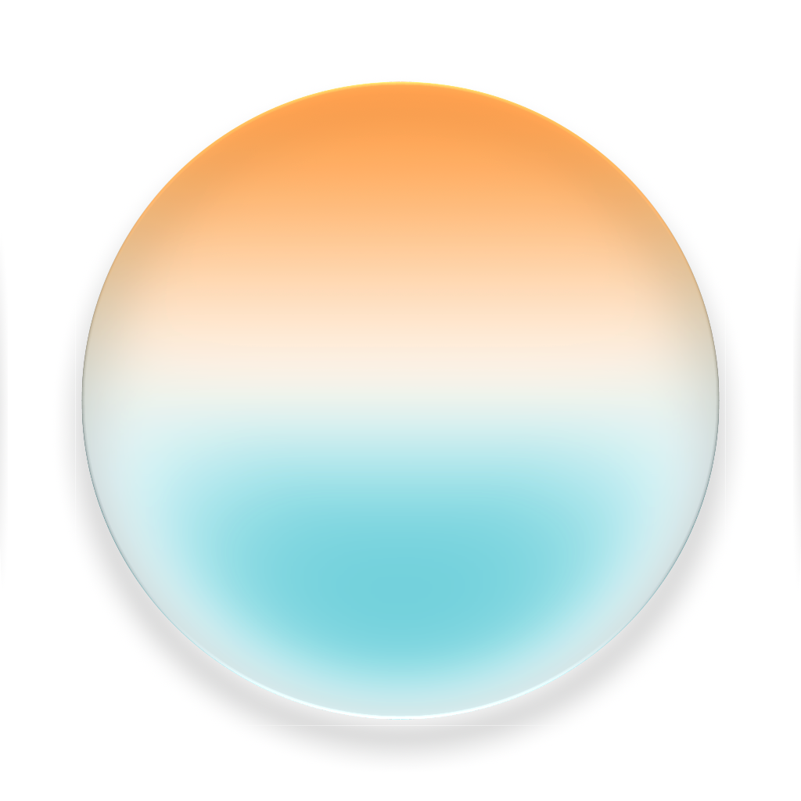
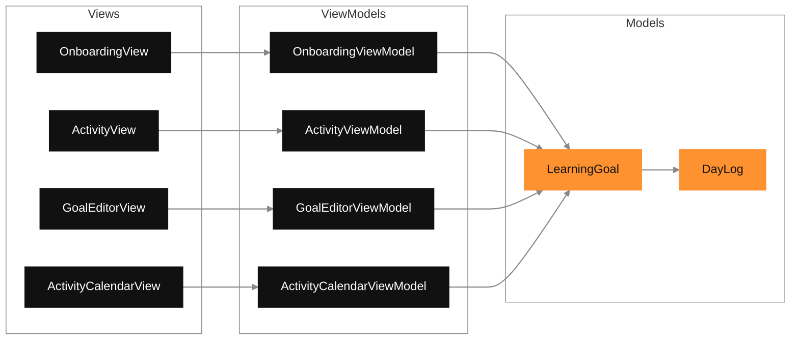

<picture>
  <source media="(prefers-color-scheme: dark)" srcset="screenshots/icon-dark.png">
  
</picture>

# Learning Journey

**Build a daily learning habit. Set a goal, log every day you learned, and protect your streak with freeze days.**

## Features

- 🎯 **Set a goal** for a week, a month, or a year
- ✅ **Log every day** you learned
- 🔥 **Build a streak** with consecutive learned days
- ❄️ **Freeze a day** without losing your streak
- 🗓️ **Calendar** with all your previous days
- 🏁 **Goal result**: achieved or missed, then start a new goal
- ✏️ **Change your goal** anytime

## Rules

| Rule | Behavior |
|---|---|
| Streak | Counts consecutive days logged as Learned. |
| Streak reset | More than 32 hours without a Learned day or a Freeze, or when a new goal starts. |
| Freeze | Keeps the streak alive without increasing it. |
| Freeze limit | 2 for a week goal, 8 for a month goal, 96 for a year goal. |
| Log button | Disabled once the day is logged as Learned. |
| Freeze button | Disabled when the day is already logged or all freezes are used. |
| New day | Buttons are enabled again at 12 AM, even if the previous log was at 11 PM. |
| Changing your mind | A frozen day can be switched to Learned on the same day (one log per day). |
| Goal result | Achieved when every day of the goal period has a log (Learned or Freeze), missed otherwise. This is a project rule, not part of the original brief. |
| Updating the goal | Creates a new goal. The old goal and its logs stay saved, and the calendar shows each day from the goal that owns it. |

## Architecture

The project follows **MVVM**.

- **Models**: `LearningGoal` and `DayLog` (SwiftData), plus `GoalDuration`, `DayStatus` and `GoalProgress`. They hold the data and the rules about the data (end date, used freezes, day coverage).
- **ViewModels** (`@Observable`): one per screen. They hold the screen state and decisions, such as whether a button is enabled.
- **Views**: SwiftUI views only display state. Reusable pieces live in a components folder (day cell, stat card, goal form, month grid, goal completed).
- **Core/DesignSystem**: design tokens (`brandPrimary`, `freeze`). System colors and text styles are used wherever the system already matches the design, so Dynamic Type is supported.

## Tech

- SwiftUI and SwiftData
- Swift Testing for unit tests
- Liquid Glass APIs (`glassEffect`, `glassProminent`)
- Minimum deployment target: iOS 27.0
- An `@AppStorage` flag (`hasSeenOnboarding`) decides between onboarding and the activity screen

## Notes for developers

- Time-dependent logic takes the current time as input (`streak(now:)`, `ActivityViewModel.now`), so it can be tested with fixed dates.
- The Activity screen refreshes the current day on `significantTimeChangeNotification` and whenever the app becomes active.
- The project uses main-actor isolation by default, so the `Codable` enums stored by SwiftData are declared `nonisolated`.

## Running the tests

Open the project in Xcode and press `Cmd + U`. The tests cover the streak and freeze rules, the midnight reset, goal completion, the goal editor, and the calendar months and days.

## Known limitations

- One calendar test is disabled until its hang is investigated.
- The app has not been tested yet on small devices or with large accessibility text sizes.
- The update alert uses the system style, so its button color follows the system.
